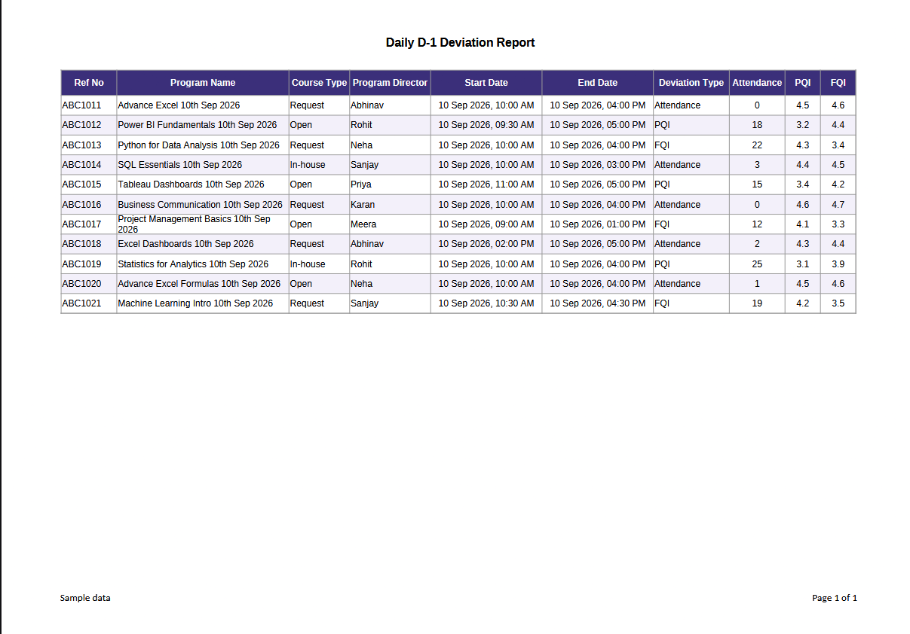
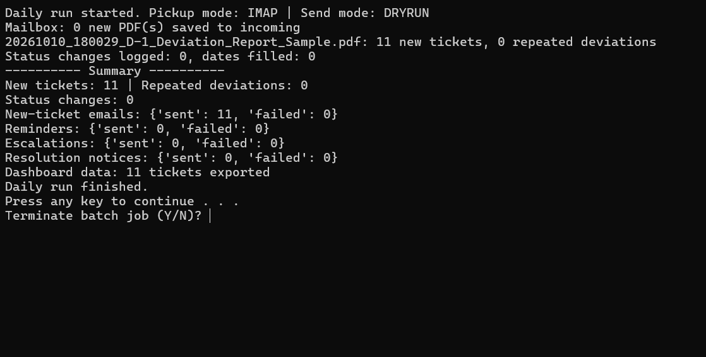
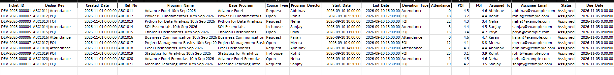
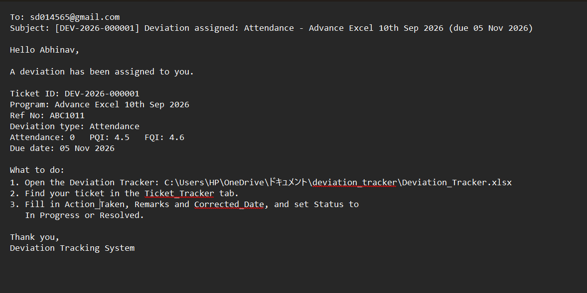
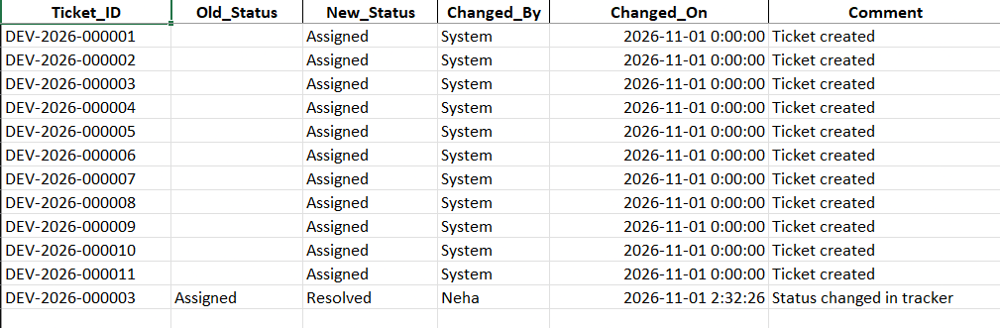
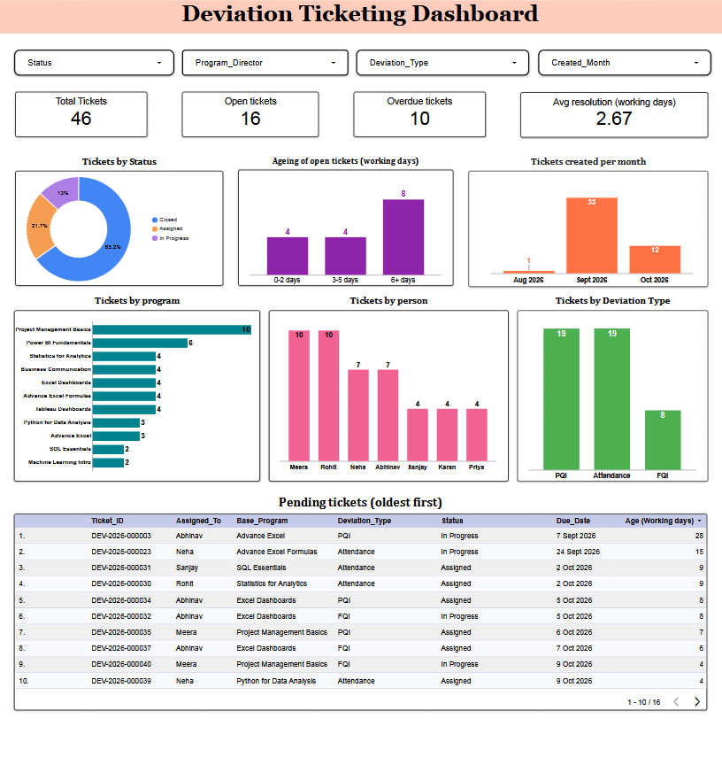

# Automated Deviation Reporting & Ticketing

Turns the daily deviation report (a PDF from Looker) into tracked tickets, from
identification to closure, with a complete history. Built with Python and Excel,
using only free tools.

> All data in this repository is **sample data**. Assignee emails use the fake
> domain `example.com`.

## How it works

Report PDF (inbox or folder) → read and clean → duplicate check → ticket,
assignee and due date → email notifications → status tracking and audit trail →
reminders and escalation → dashboard data

## See it in action

### 1. The daily report comes in

### 2. One double-click runs everything

### 3. One ticket per deviation, assigned and dated

### 4. The assignee is notified by email

### 5. Every status change is recorded

### 6. Dashboard (Looker Studio, built on practice data)

## Features

- Reads the report PDF from a folder, or from a Gmail inbox
- Cleans the data and keeps a permanent history (nothing is overwritten)
- Spots a deviation that comes again: it is counted, no duplicate ticket is made
- Creates one ticket per deviation: unique ID, assignee from a mapping table,
  due date in working days
- Emails the assignee; sends reminders; escalates to a manager; tells the
  validator when a ticket is resolved
- Records every status change (audit trail) and fills Resolved and Closed dates
- Logs every email and never sends the same email twice
- Exports a data file for the dashboard
- Runs with one double-click

## Folder contents

- `run_daily.bat` / `run_daily.py` : runs the whole daily process
- `setup_workbook.py` : creates a fresh, empty `Deviation_Tracker.xlsx`
- `mail_intake.py`, `intake.py`, `tickets.py`, `status.py`, `notify.py`,
  `export_dashboard.py` : the building blocks, in the order they run
- `xl.py`, `settings.py` : helpers and settings
- `make_practice_data.py` : makes a made-up dataset for building the dashboard
- `incoming/` : put the daily PDF here
- `processed/` : handled PDFs are moved here
- `dashboard_data/` : data files for the dashboard
- `docs/images/` : screenshots used in this README
- `BENCHMARK.md` : comparison with common ticketing practice
- `.env.example` : template for private settings

## Setup (once)

1. Install Python 3.10 or newer.
2. Install the libraries:

       pip install -r requirements.txt

3. Optional: copy `.env.example` to `.env` and fill in your values. Without a
   `.env` file the program runs safely in DRYRUN mode (no real emails).
4. Create the tracker file:

       python setup_workbook.py

## Daily use

1. Put the day's PDF in the `incoming` folder (or use the mailbox option below).
2. Close `Deviation_Tracker.xlsx` in Excel.
3. Double-click `run_daily.bat`.

**Assignees:** open `Ticket_Tracker`, find your ticket, use the Status dropdown
(Open, Assigned, In Progress, Resolved, Closed), fill in `Action_Taken`,
`Remarks` and `Corrected_Date`, then **save and close** the file. The next
daily run records the change.

**Validator:** after checking the correction, set the status to `Closed` and
fill in `Validated_By`.

## Reading the report from a mailbox

Set `PICKUP_MODE` in `.env`:

- `FOLDER` (default): the PDF is already in `incoming`
- `IMAP`: fetches the PDF attachment from a Gmail inbox. Needs `GMAIL_ADDRESS`,
  a Gmail App Password, and `LOOKER_SENDER` / `LOOKER_SUBJECT` to pick the
  right email.

Each email is handled once. This was tested with a test email in a personal
Gmail account. An Outlook version is not built.

## Email modes (`SEND_MODE` in `.env`)

| Mode | What it does |
|---|---|
| DRYRUN | Safe default. Emails are saved as text files in `email_previews`. |
| SMTP | Sends through Gmail. Needs `GMAIL_ADDRESS` and a Gmail App Password. |
| OUTLOOK | Sends through the classic Outlook desktop app (Windows, needs `pywin32`). Written, not yet tested. |

Set `TEST_RECIPIENT` in `.env` to send every email to one test address.

## Settings

- `Config` tab: `SLA_Resolve_Days` (3), `Reminder_Day` (2), `Escalation_Day` (4),
  `Validation_Days` (2). Counted in working days (weekends skipped).
- `Assignment_Mapping` tab: who gets each ticket (by Program Director and
  Deviation Type), plus the escalation and validator emails.

## Workbook tabs

| Tab | Purpose |
|---|---|
| Raw_Intake | Every row received, exactly as loaded |
| Master_Deviations | Permanent history, one row per unique deviation |
| Ticket_Tracker | One row per ticket: assignment, status, action, dates |
| Status_History | Audit trail of every status change |
| Notification_Log | Every email sent or previewed |
| Assignment_Mapping | Assignee and escalation rules |
| Config | SLA settings |

## Known limitations

- The daily run is started manually (no scheduler).
- `Changed_By` in `Status_History` assumes the assignee made the change,
  because Excel does not record who edited a cell.
- Public holidays are not counted; only weekends are skipped.
- Outlook inbox pickup is not built; Outlook sending is untested.
- The dashboard was built in Looker Studio on practice data and does not refresh
  automatically.
- Assignment rules and SLA values are sample assumptions, not confirmed rules.

## How this maps to the Microsoft design

| Planned Microsoft tool | What this project uses |
|---|---|
| Power Query (ingestion and cleaning) | `intake.py` (pandas) |
| Excel / SharePoint tracker | `Deviation_Tracker.xlsx` |
| Power Automate (tickets, notifications, reminders, escalation) | `tickets.py`, `status.py`, `notify.py`, run by `run_daily.py` |

It was built with free tools because the available Microsoft 365 account did
not include the SharePoint license needed for the original design. See
`BENCHMARK.md` for a comparison with common ticketing practice.